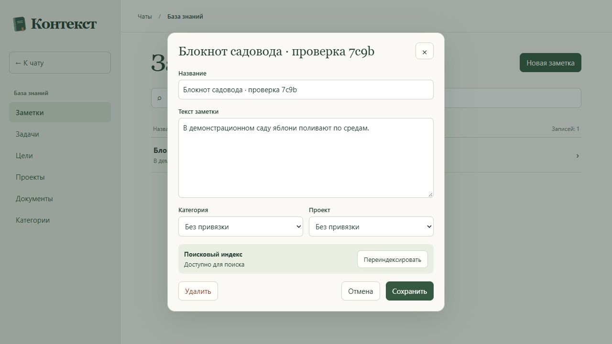
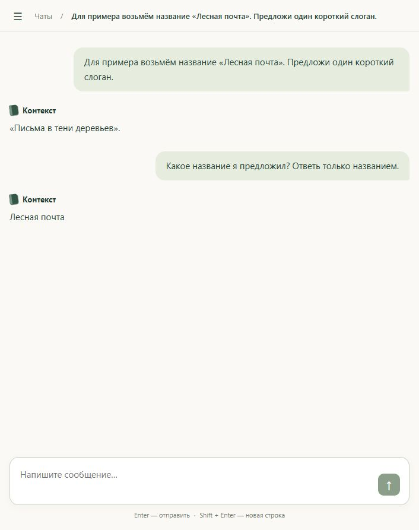
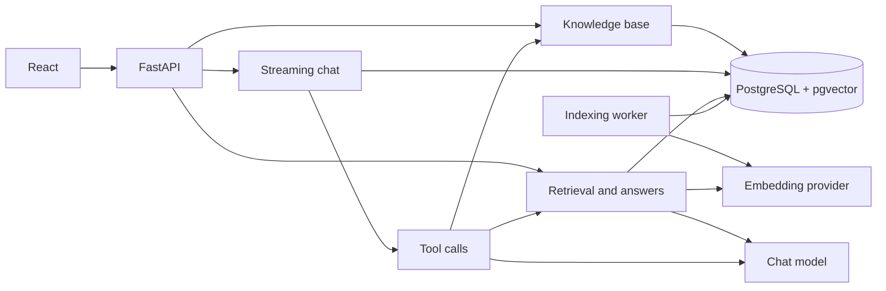

# Personal AI Assistant

A single-user workspace for turning personal notes into answers and tasks. Upload a text file, ask a question about it, and follow the answer back to the passage it came from. The chat can also create tasks, update goals, and save new notes in the same PostgreSQL database.

**Stack:** Python 3.12, FastAPI, SQLAlchemy, Alembic, PostgreSQL 16 with pgvector, React, TypeScript, and Docker Compose. The web interface is in Russian. You can ask questions in English.



## Run locally

From the repository root, with Docker Compose v2 and Linux containers available, run:

```sh
docker compose up --build -d --wait
```

Open the [web app](http://127.0.0.1:8000/), the [knowledge base](http://127.0.0.1:8000/#knowledge/notes), or the [interactive API reference](http://127.0.0.1:8000/docs). Compose serves the built frontend and the API on the same loopback address. PostgreSQL runs on the internal Compose network. On startup the API applies the migrations, including the pgvector extension.

**Without an API key**, you can create and link records, upload documents, and run the integration suite. **With an OpenRouter key**, you can index documents, search by meaning, generate answers with sources, and use tools in chat. This is a local application for one trusted user. Its HTTP endpoints do not require authentication.

### Try it with a sample document

1. Open [Documents](http://127.0.0.1:8000/#knowledge/documents), choose **Загрузить документ** (Upload document), and upload [garden-notes.txt](examples/garden-notes.txt). Open the saved document to read it. On a fresh install its index status is **В очереди** (pending).
2. To enable AI features, copy [.env.example](.env.example) to `.env` if you have not already created one. Set `OPENROUTER_API_KEY` there and rerun the startup command. **The indexer sends existing and newly added notes and document text to OpenRouter for embedding.** Questions and selected passages are also sent to the provider when generating an answer.
3. Once the document shows **Доступно для поиска** (ready), open `POST /api/rag/ask` in Swagger UI and send the request below. The sample says the orchard team waters the trees **every Wednesday morning**. Inspect `sources[0].text` and open `sources[0].url` to check the answer against the uploaded file. The generated wording can vary.

```json
{
  "question": "When does the orchard team water the apple trees?",
  "kind": "documents",
  "limit": 1
}
```

To try an action, open [Chat](http://127.0.0.1:8000/) and send *Create a high-priority task called Water the apple trees*. Look for it in [Tasks](http://127.0.0.1:8000/#knowledge/tasks). Asking the agent to delete a task opens a separate confirmation showing its title.

Press Enter to send a message or Shift + Enter to add a line. The sidebar keeps previous conversations, and reloading the page restores the last one you selected.

<details>
<summary>Chat screenshot</summary>



</details>

## How it works



| Design decision | Behavior to look for |
| --- | --- |
| Revision-aware indexing | Editing a note or replacing a file immediately excludes its old passages from search. The worker embeds overlapping chunks in batches, then checks the source revision before replacing its vectors in one transaction. Each hit carries a character offset and source URL. |
| Transactional chat turns | The backend locks the conversation and commits tool mutations with the completed reply. A client that loses the stream can retry the same message with the same `request_id`. It receives the committed turn or retries after rollback. |
| Confirmed deletion | The model can propose deleting a task. The user confirms through a separate endpoint. The confirmation expires after ten minutes and checks the task version, so an edit invalidates the original proposal. |
| Separate provider interfaces | Embeddings, answer generation, and tool calling have separate Python protocols. A different chat adapter can reuse the existing embeddings. The index profile includes the embedding provider, model, dimensions, and chunking version. |

The worker splits text into chunks of up to 1,200 characters with a 160-character overlap. Search ranks eligible passages by cosine distance and can filter by category or source type. Chat history lives outside the vector index. The model receives at most eight previous turns, with text length limits.

## API guide

The [Swagger UI](http://127.0.0.1:8000/docs) includes request schemas and lets you run each endpoint locally.

| Workflow | Endpoints and examples |
| --- | --- |
| Manage records | `/api/categories`, `/api/projects`, `/api/goals`, `/api/tasks`, `/api/notes`. Use `POST` to create and `GET` to list. Append `/{id}` to read, patch, or delete one record. Lists use `offset` and `limit` (default 50, maximum 200). |
| Link a task | Set `project_id`, `goal_id`, or `category_id`. Send `null` in a patch to clear a link or date. Deleting a linked project, goal, or category preserves the task. |
| Store a document | `POST /api/documents` accepts a UTF-8 `.txt` file up to 1 MiB, including UTF-8 with BOM. `PUT /api/documents/{id}` replaces the file under the same ID. `GET /api/documents/{id}/content` returns the original text. |
| Inspect the index | `GET /api/index/{kind}/{id}` reports `pending`, `ready`, or `failed` for `notes` or `documents`. On failure, inspect `error`, fix the cause, and `POST` to the same URL to requeue. With no key, records stay pending. |
| Search and answer | `POST /api/rag/search` returns matching passages. `POST /api/rag/ask` returns an answer and sources. Both accept `question`, `limit`, and optional `kind` and `category_id`. |
| Stream chat | `POST /api/chats` creates a conversation. List conversations with `GET /api/chats` or read one at `GET /api/chats/{id}`. Send a `message` and UUID `request_id` to `POST /api/chats/{id}/messages`. Each NDJSON line contains a `delta`, `tool`, `done`, or `error` event. |
| Run one agent turn | `POST /api/agent/run` accepts `{"message":"Show my tasks"}` and returns the reply, tool calls, and pending confirmations. Send `{"confirm":true}` or `{"confirm":false}` to `POST /api/agent/confirmations/{action_id}` to resolve a deletion request. |

For example, send `{"title":"Water the apple trees","priority":"high"}` to `POST /api/tasks`. The task starts in `todo`. Send `{"status":"done"}` to `PATCH /api/tasks/{id}` using the returned ID. The intermediate status is `in_progress`.

## Configuration and data

| Setting | Purpose |
| --- | --- |
| `API_PORT` | Host port for the web app and API, default `8000`. |
| `POSTGRES_DB`, `POSTGRES_USER`, `POSTGRES_PASSWORD` | Initial database settings. PostgreSQL applies them when it creates a new data volume. |
| `OPENROUTER_API_KEY` | Enables the AI provider for both the API and the indexing worker. |
| `OPENROUTER_CHAT_MODEL` | Defaults to `openrouter/free`. Chat needs streaming and tool calling support. |
| `OPENROUTER_EMBEDDING_MODEL` | Defaults to `nvidia/nemotron-3.5-embed-1b:free`. The adapter takes the first 1,536 components of its 2,048-dimensional output. Other models must return 1,536 dimensions for the current schema. |

Run `docker compose logs api indexer db` to inspect the services. Stop them with `docker compose down`. Documents, vectors, and chat history persist in the project's `postgres_data` named volume.

## Tests

The [CI workflow](.github/workflows/ci.yml) builds the TypeScript frontend and Python service, starts PostgreSQL from an empty volume on the runner, applies migrations, and runs the integration suite against the running app. The tests exercise real database constraints and pgvector ordering. Scripted models, deterministic vectors, and mocked provider HTTP responses keep the suite independent of model availability and paid API calls.

For an end-to-end example, see `test_chat_search_links_back_to_uploaded_text` in [the agent tests](backend/tests/test_agent.py). It uploads a document, indexes it, streams a chat turn that calls search, and follows the returned source URL back to the original text. The test also checks what the model received and what the user sees when reopening the conversation.

To reproduce CI locally alongside your personal instance, run these commands from the project root in a fresh shell. The example configuration supplies an empty provider key. The distinct Compose project has its own database volume.

In PowerShell, set `$env:API_PORT = '0'` for this shell or, in Bash, run `export API_PORT=0`. Docker then assigns an available loopback port. The suite runs inside the API container and uses its internal port.

```sh
docker compose --env-file .env.example -p assistant-test up --build -d --wait
docker compose --env-file .env.example -p assistant-test exec -T api python -m unittest discover -s tests -v
docker compose --env-file .env.example -p assistant-test down
```

The liveness endpoint at `GET /health/live` checks that the API can handle requests. Readiness at `GET /health/ready` additionally verifies database access and the vector extension. Inspect the active migration with `docker compose exec api alembic current`.

## Code map

| Location | Responsibility |
| --- | --- |
| [backend/app/knowledge](backend/app/knowledge) | Resource routes and Pydantic schemas |
| [backend/app/db](backend/app/db) | ORM models, repositories, vector search, and confirmation state |
| [backend/app/rag](backend/app/rag) | Chunking, indexing worker, retrieval, and provider implementations |
| [backend/app/rag/wiring.py](backend/app/rag/wiring.py) | Adapter selection for embeddings, generation, and tool calling |
| [backend/app/agent](backend/app/agent) | Validated tool registry and agent execution loop |
| [backend/app/chat](backend/app/chat) | Streaming conversations and request replay |
| [backend/migrations](backend/migrations) | Alembic schema revisions |
| [backend/tests](backend/tests) | HTTP integration tests, database tests, and provider adapter tests |
| [frontend/src](frontend/src) | React chat and knowledge base UI |
