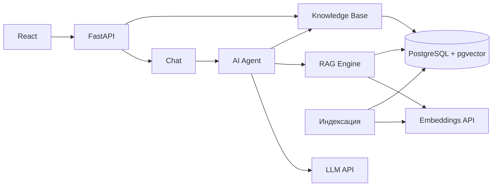

# Personal AI Assistant

Локальный персональный ассистент для одного владельца. Через FastAPI можно вести проекты, цели, задачи, заметки и категории. Данные хранятся в PostgreSQL 16.
## Запуск

Из корня проекта при работающем Docker Desktop в режиме Linux-контейнеров выполните:

```powershell
docker compose up --build -d --wait
```

Откройте [Swagger UI](http://127.0.0.1:8000/docs). Compose публикует API на loopback, а база доступна по имени `db` внутри сети Compose. Данные сохраняются в именованном томе `postgres_data`. При старте API ждёт готовности PostgreSQL, применяет миграции и запускает Uvicorn.

Значения для первого запуска заданы в Compose. Чтобы выбрать другой порт API или параметры новой базы, скопируйте `.env.example` в `.env` и измените значения перед запуском. PostgreSQL использует параметры создания пользователя и базы при первой инициализации тома.

## Чат

Откройте [Контекст](http://127.0.0.1:8000/) в браузере. Введите сообщение или выберите подсказку. Enter отправляет сообщение, Shift + Enter добавляет строку. В боковой панели можно начать новый диалог и вернуться к предыдущему. После обновления страницы открывается последний выбранный диалог.

Ответ появляется по мере генерации. Под ответом поиска доступны найденные фрагменты и ссылки на исходные записи. Запрос удаления показывает название задачи и отдельные кнопки подтверждения и отмены. Для работы требуется настроенный провайдер с поддержкой streaming и tool calling.

PostgreSQL хранит завершённые обращения, результаты инструментов и ссылки. Модель получает до восьми последних обращений текущего диалога с ограничением длины текста. История отделена от векторного индекса. Изменения инструментов и завершённый ответ фиксируются в одной транзакции. Если передача оборвалась, повтор того же запроса с тем же `request_id` возвращает уже сохранённый результат или выполняет запрос после отката.

`POST /api/chats` создаёт диалог, `GET /api/chats` возвращает список, `GET /api/chats/{id}` открывает историю. `POST /api/chats/{id}/messages` принимает `message` и UUID `request_id`, затем передаёт события `delta`, `tool`, `done` или `error` в формате NDJSON.

## Работа с базой знаний

Откройте [Базу знаний](http://127.0.0.1:8000/#knowledge/notes) по ссылке в шапке чата. Разделы доступны в боковой панели, а на узком экране — в выпадающем списке. Для редактирования выберите запись по названию. Задачи можно связать с целью, проектом и категорией, изменить срок, приоритет и статус. Удаление требует подтверждения.

В разделе «Документы» можно загрузить UTF-8 файл `.txt` до 1 МиБ, открыть текст и сменить категорию. Кнопка «Заменить файл» обновляет содержимое под тем же ID. В карточках документов и заметок видны состояние поискового индекса, причина ошибки и кнопка переиндексации. Открытая карточка автоматически обновляет статус, пока запись находится в очереди и настроен провайдер.

В Swagger UI откройте группу ресурса и нажмите **Try it out**. Для каждого ресурса доступны создание и список (`POST` и `GET /api/{resource}`), просмотр, частичное изменение и удаление по ID (`GET`, `PATCH`, `DELETE /api/{resource}/{id}`). Список упорядочен по ID и принимает `offset` и `limit` (по умолчанию 50, максимум 200).

| Ресурс | Поля |
| --- | --- |
| `categories` | Название |
| `projects` | Название, описание, категория |
| `goals` | Название, описание, категория, целевая дата |
| `tasks` | Название, описание, категория, проект, цель, срок, статус и приоритет |
| `notes` | Название, текст, категория, проект |

Например, отправьте в `POST /api/tasks` тело `{"title":"Разобрать заметки","priority":"high"}`. Задача получит статус `todo`. По возвращённому ID отправьте `{"status":"done"}` в `PATCH /api/tasks/{id}`. Для промежуточного состояния используйте `in_progress`.

Связи задаются полями `project_id`, `goal_id` и `category_id`. Чтобы снять связь или очистить дату, передайте `null` в PATCH. При удалении проекта, категории или цели PostgreSQL снимает соответствующие связи и сохраняет связанные записи. Несуществующий ID в ссылке даёт HTTP 422, обращение к отсутствующей записи по её собственному ID — HTTP 404.

## Поиск по заметкам и документам

В Swagger UI загрузите текстовый файл через `POST /api/documents`. Поддерживается UTF-8 (включая BOM), до 1 МиБ. Содержимое хранится в PostgreSQL. `PUT /api/documents/{id}` заменяет файл, а `GET /api/documents/{id}/content` открывает его текст. Заметки индексируются из поля `body`.

Для семантического поиска задайте `OPENROUTER_API_KEY` в локальном `.env` и выполните `docker compose up --build -d --wait`. При добавлении ключа обработчик автоматически отправит тексты накопленных заметок и документов в OpenRouter для получения embeddings. При ответе модель получает вопрос и выбранные фрагменты с заголовками. Переменные `OPENROUTER_EMBEDDING_MODEL` и `OPENROUTER_CHAT_MODEL` задают модели отдельно. По умолчанию ответы генерирует бесплатный маршрутизатор `openrouter/free`, а поиск использует `nvidia/nemotron-3.5-embed-1b:free`. Для существующей колонки pgvector адаптер берёт первые 1536 координат вектора Nemotron. Для другой модели выберите нативную размерность 1536. [Документация OpenRouter по embeddings](https://openrouter.ai/docs/api/reference/embeddings).

1. Проверьте `GET /api/index/notes/{id}` или `GET /api/index/documents/{id}`. Статус `pending` означает ожидание или обработку. После успешной записи фрагментов появится `ready`. Без ключа запись остаётся в ожидании, а поиск и генерация возвращают HTTP 503.
2. Отправьте `{"question":"Что я решил по переезду?","limit":3}` в `POST /api/rag/search` для поиска или в `POST /api/rag/ask` для ответа с источниками. Можно указать `category_id` и `kind` (`notes` или `documents`). Каждый результат содержит текст, смещение в символах, ссылку и косинусное расстояние. Чем оно меньше, тем ближе фрагмент к запросу.
3. После изменения текста поиск сразу исключает прежнюю версию. Отдельный процесс `indexer` делит текст на перекрывающиеся фрагменты, получает embeddings пакетами и в одной транзакции заменяет старые векторы. Ревизия защищает от публикации устаревшего результата. Удаление источника удаляет его фрагменты. Смена модели или версии алгоритма запускает переиндексацию.
4. Если обработка завершилась со статусом `failed`, поле `error` содержит причину. После устранения ошибки выполните `POST /api/index/{kind}/{id}`. Эта команда также позволяет вручную перестроить готовый индекс.

Ответы и векторизация подключаются независимо через интерфейсы `Generator` и `Embeddings`. Выбор адаптеров сосредоточен в `backend/app/rag/wiring.py`. Например, для локальной Qwen через Ollama достаточно подключить там реализацию `Generator`. Поиск продолжит использовать текущие embeddings. Переиндексация нужна при смене поставщика векторов или embedding-модели.

## Агент и инструменты

В Swagger UI откройте `POST /api/agent/run` и попробуйте `{"message":"Создай задачу Купить чай с высоким приоритетом"}`. Ответ содержит текст ассистента, фактические вызовы в `tools` и список ожидающих решений в `confirmations`. Каждый запрос представляет отдельное обращение. Используйте ID из результата, например «Отметь задачу 7 выполненной».

Доступны `search_knowledge`, `create_task`, `update_task`, `get_tasks`, `delete_task`, `create_goal`, `update_goal`, `get_projects` и `save_note`. Модель предлагает имя и параметры. Backend валидирует их и вызывает репозитории или поиск. Изменения одного обращения фиксируются после итогового ответа модели. Для вызова инструментов используется отдельный интерфейс `ToolCaller`.

При запросе удаления найдите в `confirmations` ID подтверждения, ID и название задачи. Отправьте `{"confirm":true}` в `POST /api/agent/confirmations/{action_id}` для удаления или `{"confirm":false}` для отмены. Подтверждение действует 10 минут и привязано к версии задачи. После изменения задачи запросите удаление заново. [Формат вызовов инструментов OpenRouter](https://openrouter.ai/docs/guides/features/tool-calling).

## Проверка

| Маршрут | Что проверяет |
| --- | --- |
| `GET /health/live` | Процесс API обрабатывает HTTP-запросы |
| `GET /health/ready` | API подключается к базе приложения и находит установленное расширение vector. При недоступности базы или отсутствии расширения возвращает HTTP 503 |

Интеграционные тесты обращаются к запущенному API и сверяют ревизию базы с текущей миграцией:

```powershell
docker compose exec api python -m unittest discover -s tests -v
docker compose exec api alembic current
```

Просмотр журналов и остановка с сохранением тома:

```powershell
docker compose logs api db
docker compose down
```

## Устройство backend

```text
backend/
  app/main.py        создание FastAPI, жизненный цикл соединений, HTTP-диагностика
  app/db/            подключение SQLAlchemy, ORM-модели, репозиторий и диагностика
  app/knowledge/     HTTP-маршруты базы знаний и схемы валидации
  app/chat/          диалоги и потоковые ответы
  app/agent/         инструменты и управление вызовами
  app/rag/           адаптер OpenRouter, обработчик фрагментов, retrieval и ответы
  migrations/        окружение Alembic и версии схемы
  tests/             интеграционные проверки запущенного приложения
  pyproject.toml     пакет Python и зависимости
frontend/            React и TypeScript, сборка Vite
compose.yaml         API с интерфейсом, индексатор и PostgreSQL
```

Для коротких диагностических запросов используются синхронные обработчики FastAPI и пул соединений SQLAlchemy. Код приложения и миграции получают параметры подключения из одних и тех же переменных окружения. Первая миграция устанавливает расширение vector в базу приложения.

## Направление разработки

Шесть этапов MVP реализованы. Выбор провайдера генерации и embeddings остаётся независимым, что позволяет в дальнейшем добавить локальную модель.


